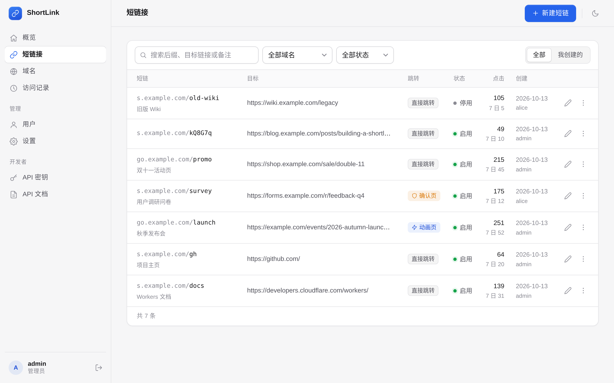
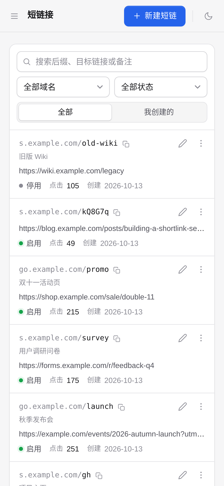
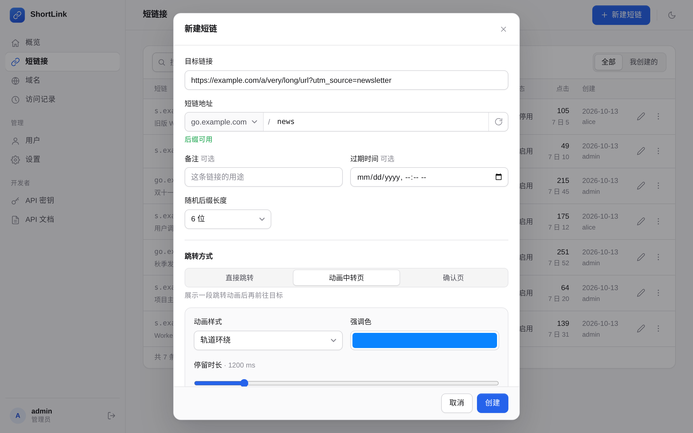
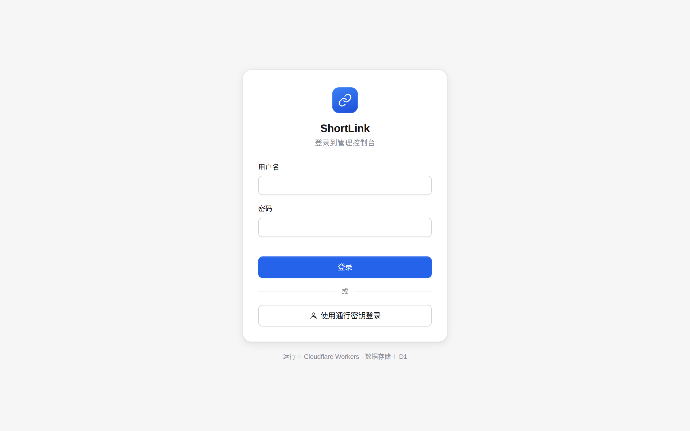
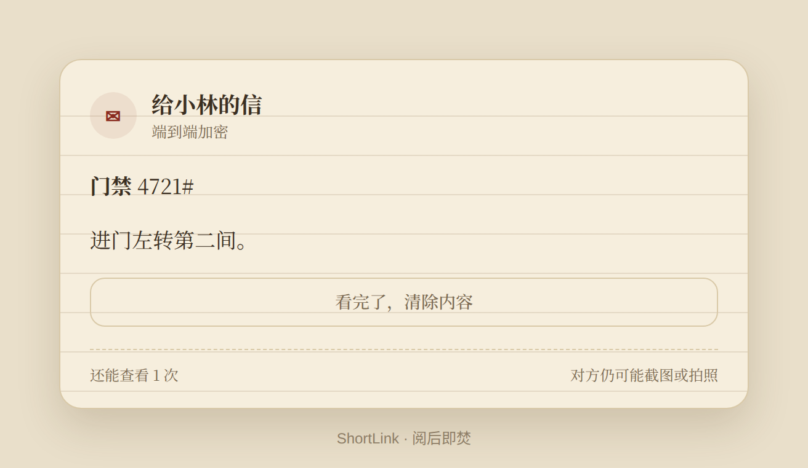
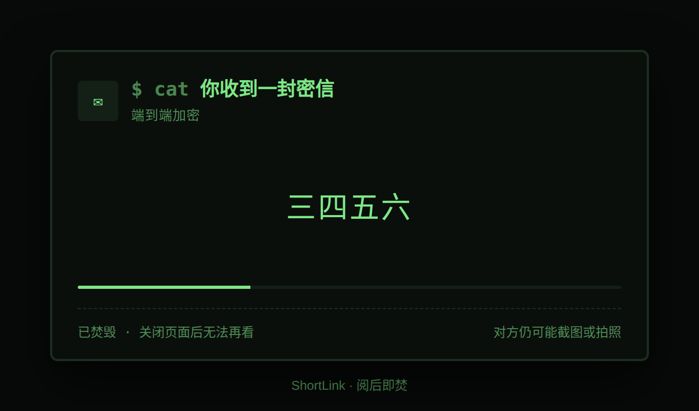
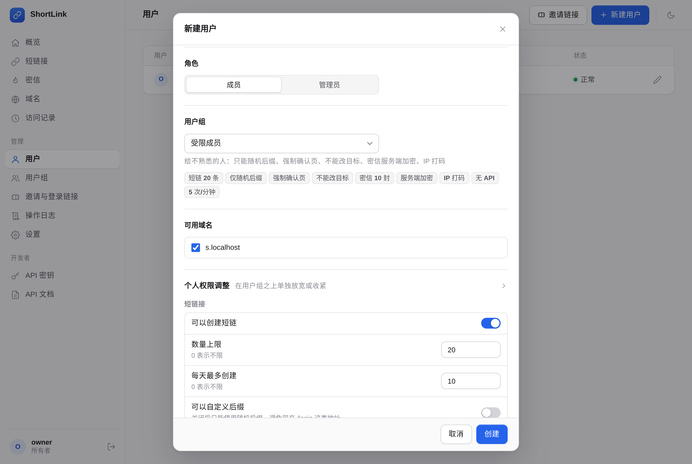
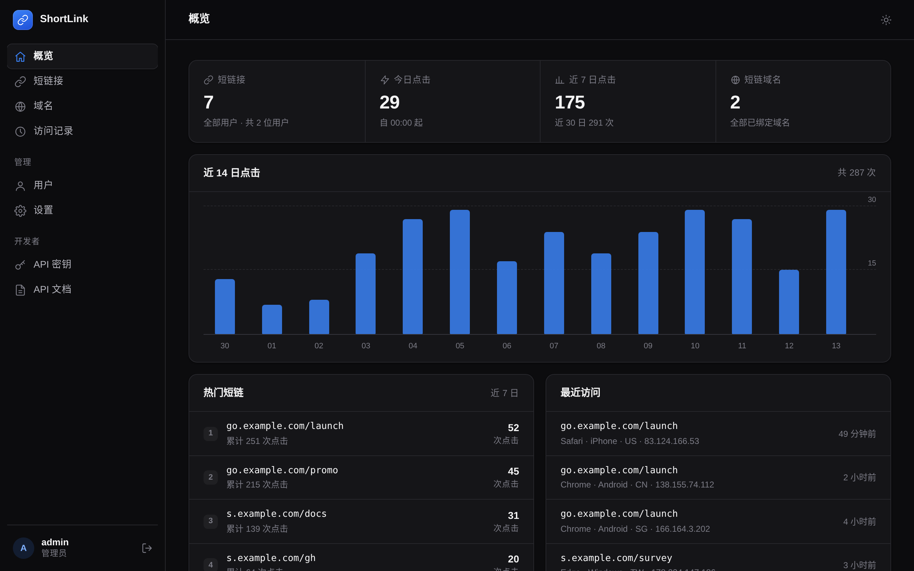

# ShortLink

一个跑在 Cloudflare Workers 上的自托管短链接服务，附带阅后即焚的「密信」。一个 Worker 包含了管理控制台、REST API、跳转页、密信页和定时任务，数据存在 D1。没有运行时依赖，前端也不需要构建。

免费套餐就能跑：Workers 每天 10 万次请求、D1 5 GB 存储，个人和小团队足够用。


## 功能

**短链**
- 自定义后缀，或自动生成 4–10 位随机后缀（避开 `0/O`、`1/l` 这类易混字符）
- 支持备注、过期时间、启用/停用；目标、后缀、域名创建后都能改
- 三种跳转方式：直接 302、动画中转页（4 种动画，可设时长/标题/文案/颜色）、确认页（访客确认目的地后再跳）

**密信（阅后即焚）**
- 内容在浏览器里用 AES-GCM 加密，解密密钥只放在链接 `#` 后面，服务器和管理员都看不到；也可以选服务端加密，便于管理员处理举报
- 限制查看次数、有效期、首次打开后多久失效、访问密码（错误太多次自动销毁）
- 访客点「查看」时才取回内容并计数，聊天软件的链接预览不会把次数用掉；链接里的密钥不对时直接拒绝，不浪费次数
- 内容画在 canvas 上，不可选中、不可复制、不在网页源码里；六种显示方式，含两种**防截图**效果：运动噪点、互补帧（单张截图只有噪点，人眼连续可读），以及直接显示、逐字、滑动窗口、倒计时
- 可附带图片（端到端同样加密，存在 R2）：打开时画在 canvas 上，和文字一样不可下载、不可直接读取。需先启用 R2（见部署），未启用时控制台不显示图片入口
- 创建时可把常用配置存成模板，下次一键套用；可选给每封信配一个 https Webhook，被打开时推送通知
- 四套页面风格（极简、信笺、终端、暗夜），可选切出页面即模糊、读完后显示结束语或跳转
- 创建时右侧实时预览、参数可拖动即时生效；每次打开和被拒原因都有记录

**聊天室（实时）**
- 用一个链接拉起的实时聊天：单聊、群聊、焰信（服务器不存消息）
- 端到端加密，服务器只转发密文；消息用上面同样的显示方式渲染，可设阅后消失、按住查看、切出模糊
- 可配置成员互相可见的信息（设备、地区、当地时间、IP、正在输入），IP 默认关闭
- 在线状态、正在输入、历史回放；基于 Cloudflare Durable Objects，空闲休眠不计费

**多域名**
- 一个 Worker 绑定任意多个域名，分为「管理域名」（打开控制台）和「短链域名」（生成链接）
- 每个域名可以设置自己的默认跳转方式

**访问统计**
- 每次访问记录时间、IP、国家/城市、浏览器、系统、来源页
- 概览页有 14 日趋势、热门短链和实时访问；单条短链的记录可分页查看、导出 CSV

**账户与权限**
- 用户名密码登录，也支持通行密钥（Passkey：指纹 / Face ID / 硬件钥匙）
- 三层权限：唯一的所有者、可拆分权限的管理员（用户 / 域名 / 设置 / 全部内容）、用户组
- 用户组控制能做什么、能用多少：数量和每日额度、限速、能否自定义后缀、可用跳转方式、创建后能否改目标、密信加密方式和上限、访问记录 IP 是否打码、API 范围；每个人还可以单独调整
- 内置「可信成员」「普通成员」「受限成员」三个预设，受限预设适合给不熟悉的人用：只能随机后缀、强制确认页、不能改目标、密信服务端加密
- 开号方便：邀请链接（绑定用户组、人数、有效期）、登录链接（点开即登录，可随时撤销）、临时账号、首次登录强制改密
- 一键冻结：停用账户、停用他发布的全部内容、注销所有设备；操作日志记录登录和管理操作

**API**
- API 密钥按权限范围（scope）授权，可设有效期，服务端只存哈希
- `/api/v1` REST 接口，开启 CORS，控制台内置中文文档页 `/docs`

**维护**
- Cron 每小时清理过期会话、超期访问记录和过期短链，保留天数可在设置里调整

**界面**
- 明暗两套主题，跟随系统也可手动切换
- 桌面端侧边栏，手机端抽屉菜单和底部弹层

<table>
  <tr>
    <td width="68%"></td>
    <td></td>
  </tr>
  <tr>
    <td></td>
    <td></td>
  </tr>
  <tr>
    <td></td>
    <td></td>
  </tr>
</table>

<details>
<summary>用户组与个人权限调整</summary>


</details>

<details>
<summary>深色模式</summary>


</details>

## 部署

需要：Node.js 18+，一个 Cloudflare 账号，以及至少一个已经接入该账号的域名。

### 1. 获取代码并登录

```bash
git clone https://github.com/jiangmuran/shortlink-worker.git
cd shortlink-worker
npm install
npx wrangler login
```

### 2. 创建数据库

```bash
npx wrangler d1 create shortlink
```

把输出里的 `database_id` 填进 `wrangler.jsonc`，替换 `<YOUR_D1_DATABASE_ID>`。

**可选：图片附件（R2）。** 密信里的图片存在 R2。不需要可跳过——控制台会自动隐藏图片入口。需要就创建一个桶（名字要和 `wrangler.jsonc` 里 `r2_buckets` 的 `bucket_name` 一致，默认 `shortlink-media`）：

```bash
npx wrangler r2 bucket create shortlink-media
```

### 3. 建表并部署

```bash
npm run db:migrate    # 在远程 D1 上执行 migrations/
npm run deploy
```

### 4. 绑定域名

两种方式任选一种：

- 在 `wrangler.jsonc` 里取消 `routes` 的注释，填上自己的域名，再执行一次 `npm run deploy`
- 或者在 Cloudflare Dashboard 打开这个 Worker → **设置 → 域名和路由 → 添加 → 自定义域**

至少需要两个（子）域名，一个域名只能承担其中一种用途：

| 用途 | 示例 | 说明 |
| --- | --- | --- |
| 管理域名 | `sl.example.com` | 打开控制台 |
| 短链域名 | `s.example.com` | 生成出来的短链用这个，可以有多个 |

指向这个 Worker、但还没在控制台登记的域名会显示控制台；登记为短链域名之后才开始处理跳转。

### 5. 初始化

浏览器打开管理域名，按引导设置站点名和管理员账户。当前访问的域名会自动登记为管理域名，然后在「域名」页面添加短链域名就可以开始用了。

> 通行密钥和注册时所在的域名绑定，换了管理域名需要重新添加。

### 更新

```bash
git pull
npm run db:migrate    # 有新迁移时才会执行
npm run deploy
```

## 本地开发

```bash
cp .dev.vars.example .dev.vars   # DEV_MODE=true：本地不强制 HTTPS
npm run db:migrate:local
npm run dev                      # http://localhost:8787
```

`npm run dev` 带了 `--test-scheduled`，访问 `http://localhost:8787/__scheduled` 可手动触发清理任务。

本地测试时用 `localhost`，不要用 `127.0.0.1`：会话 Cookie 带 `Secure`，浏览器和 curl 只在 `localhost` 上会接受。

### 测试

两套测试都会**清空本地数据库**，请在本地开发环境运行：

```bash
npx wrangler dev --port 8787                  # 另开一个终端
npm run test:api                              # 接口测试：权限、邀请、冻结、密信完整流程、并发打开等
PLAYWRIGHT=/path/to/playwright-core/index.mjs npm run test:ui   # 浏览器测试，需要 playwright-core 和 Chromium
```

端口不是 8787 时加 `BASE=http://localhost:端口`。

## API

在控制台「API 密钥」页面创建密钥，然后：

```bash
KEY=sk_xxxxxxxx

# 创建短链（code 留空则随机生成）
curl -X POST https://sl.example.com/api/v1/links \
  -H "Authorization: Bearer $KEY" \
  -H "Content-Type: application/json" \
  -d '{"url": "https://example.com/some/long/path", "domain": "s.example.com", "code": "demo"}'

# 列出短链
curl https://sl.example.com/api/v1/links -H "Authorization: Bearer $KEY"
```

| 方法 | 路径 | 权限 |
| --- | --- | --- |
| `GET` | `/api/v1/me` | 任意 |
| `GET` | `/api/v1/domains` | `domains:read` |
| `GET` | `/api/v1/links` | `links:read` |
| `POST` | `/api/v1/links` | `links:write` |
| `GET` | `/api/v1/links/:id` | `links:read` |
| `PATCH` | `/api/v1/links/:id` | `links:write` |
| `DELETE` | `/api/v1/links/:id` | `links:write` |
| `GET` | `/api/v1/links/:id/stats` | `logs:read` |

参数和返回格式见部署后的 `/docs` 页面。

## 项目结构

```
├── wrangler.jsonc        Worker 配置（静态资源 / D1 / Cron）
├── migrations/           D1 建表语句
├── src/
│   ├── index.js          入口：按域名分流到控制台或短链跳转，分发 API
│   ├── router.js         路径路由
│   ├── auth.js           会话、API 密钥、管理员权限、用户的有效权限
│   ├── caps.js           用户组能力模型（字段定义、合并、校验）
│   ├── links-service.js  短码分配、额度、权限检查（控制台和 /api/v1 共用）
│   ├── api-notes.js      密信：创建、列表、销毁；公开的打开接口
│   ├── api-chat.js       聊天室：创建、列表、销毁；公开的房间信息接口
│   ├── chat-room.js      ChatRoom Durable Object（WebSocket 中转、在线状态、消息留存）
│   ├── room-socket.js    聊天室 WebSocket 入口：校验、组装身份、转发到 DO
│   ├── usage.js          限速与每日额度计数
│   ├── audit.js          操作日志
│   ├── crypto.js         PBKDF2 密码哈希、HMAC 签名
│   ├── webauthn.js       CBOR 解码，WebAuthn 注册与断言验签
│   ├── api-auth.js       /api/setup  /api/auth  /api/me
│   ├── api-main.js       /api/links  /api/domains  /api/logs  /api/stats
│   ├── api-admin.js      /api/users  /api/groups  /api/access-tokens  /api/audit  /api/keys  /api/settings
│   ├── api-v1.js         /api/v1 公共 API（密钥认证 + CORS）
│   ├── redirect.js       短链域名的请求处理与访问记录
│   ├── pages.js          中转页、确认页、错误页
│   └── cleanup.js        定时任务：点击按天汇总、密信到期销毁、分批清理
├── public/               控制台前端（原生 JS，无构建）
│   ├── secure-render.js  安全文字渲染器：把文字画到 canvas，不可复制、不入 DOM；运动噪点 / 互补帧
│   ├── note.js note.css  密信访客页（控制台预览复用）
│   └── chat.js chat.css  聊天室访客页
└── tests/                接口测试与浏览器测试
```

## 安全

- 密码：PBKDF2-SHA256，10 万轮，加盐
- 通行密钥：公钥存在 D1，用 WebCrypto 验证 ES256 / RS256 签名，自己实现、不依赖第三方库
- 会话：Cookie 为 `HttpOnly` + `Secure` + `SameSite=Lax`，会话记录在服务端，可随时吊销；改密码或改权限时自动清理相关会话
- 写操作校验 `Origin`，防止跨站请求
- API 密钥只存 SHA-256 摘要，明文只在创建时显示一次
- 短链目标只允许 `http` / `https`，页面输出全部做 HTML 转义；密信的 Markdown 渲染先转义再处理，链接只允许 http(s)
- 密信页带 `Referrer-Policy: no-referrer`、`Cache-Control: no-store`，打开次数用单条带条件的 UPDATE 扣减，并发打开不会多给
- 密信内容和聊天消息画在 canvas 上，不进 DOM、不可选中复制，并禁用右键与复制；端到端加密下密文过网，F12 的网络面板也看不到明文
- 说明：端到端加密必须在浏览器里解密才能显示，所以懂调试的人仍可能从内存里取到明文、也挡不住用另一台设备拍照——这些手段只是把门槛抬高，不是绝对不可提取

发现安全问题请通过 GitHub 私下报告（Security → Report a vulnerability），不要直接开公开 issue。

## 许可

[MIT](LICENSE)
